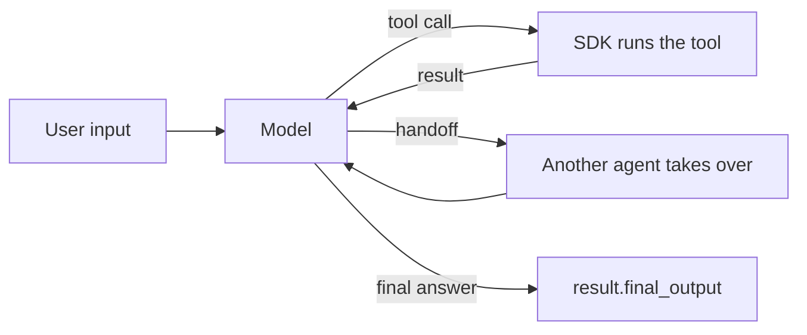
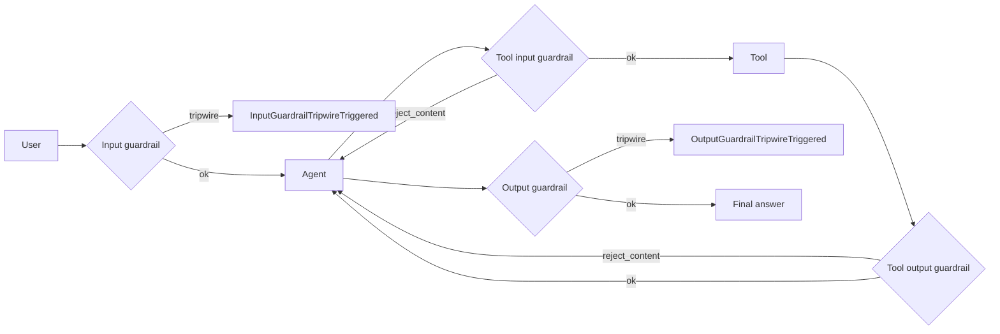
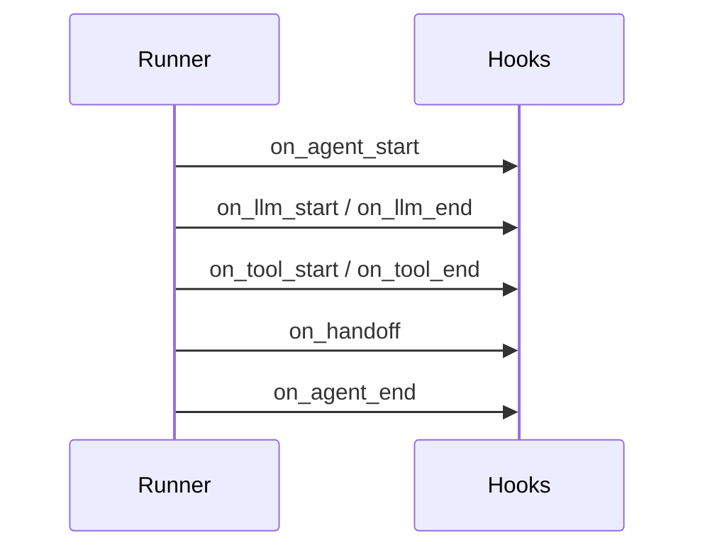
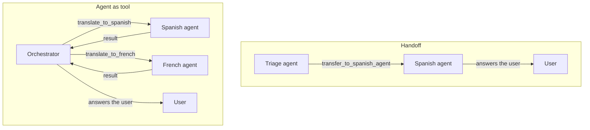
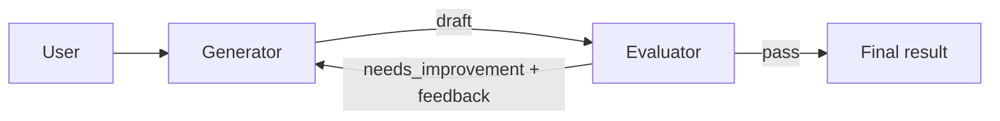
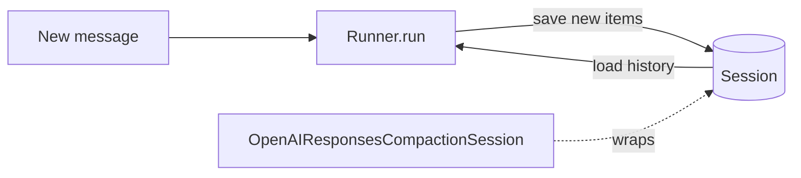
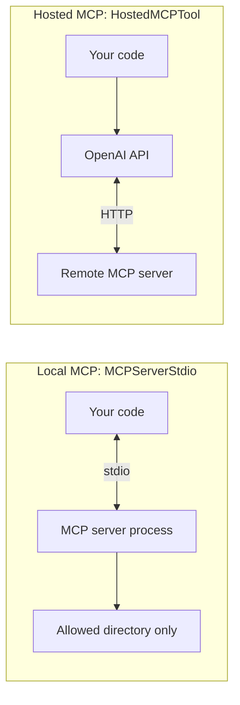
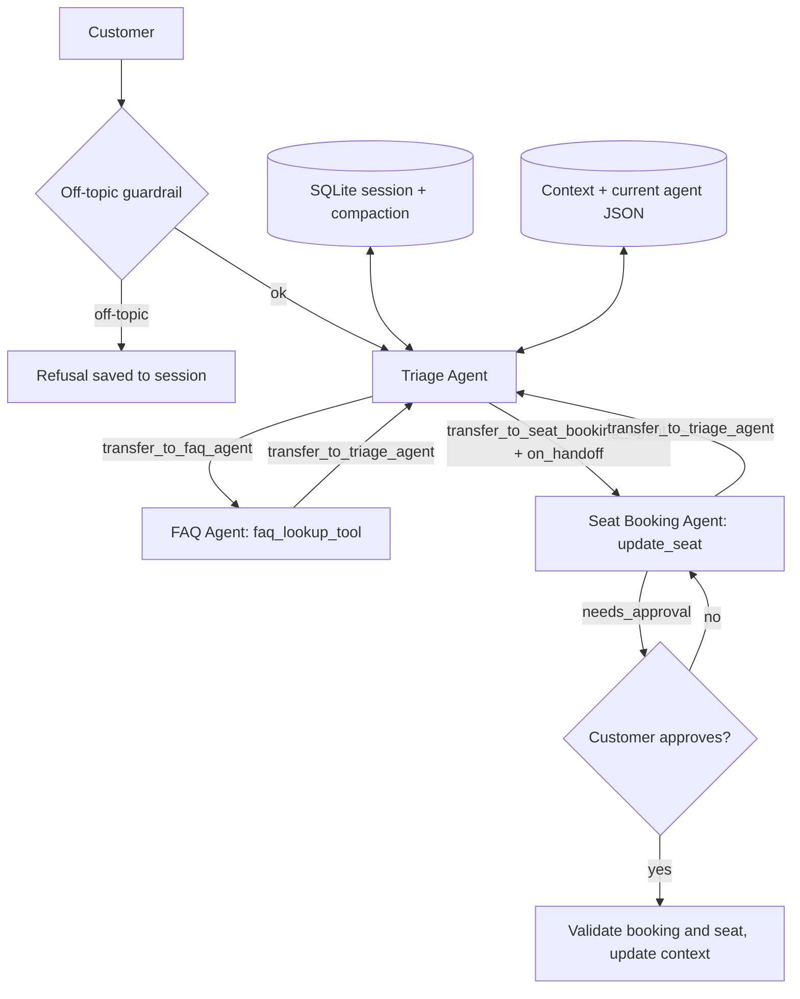

# Learning notes: OpenAI Agents SDK

Personal study notes from working through the examples in this repository. The original project README is untouched in [README.md](README.md).

Run any example from the repository root:

```bash
make sync                      # once
export OPENAI_API_KEY=sk-...
uv run python examples/basic/hello_world.py
uv run python -m examples.agent_patterns.routing   # examples that import examples.auto_mode
```

## Contents

1. [Agents and the run loop](#1-agents-and-the-run-loop)
2. [Context and dynamic instructions](#2-context-and-dynamic-instructions)
3. [Tools](#3-tools)
4. [Guardrails](#4-guardrails)
5. [Streaming](#5-streaming)
6. [Structured outputs](#6-structured-outputs)
7. [Lifecycle hooks](#7-lifecycle-hooks)
8. [Handoffs vs agents as tools](#8-handoffs-vs-agents-as-tools)
9. [Multi-agent patterns](#9-multi-agent-patterns)
10. [Sessions and compaction](#10-sessions-and-compaction)
11. [MCP](#11-mcp)
12. [Final project: customer service](#12-final-project-customer-service)
13. [Security takeaways](#13-security-takeaways)

## 1. Agents and the run loop

An `Agent` is a model plus `instructions` (the system prompt), and optionally tools, handoffs, guardrails and an output type. `Runner.run` drives the loop: it calls the model, executes any tool calls or handoffs the model requests, and repeats until the model produces a final answer.



- The model decides whether to use a tool and which arguments to pass. The tool result always goes back to the model.
- Each `Runner.run` starts with no memory. Pass `result.to_input_list()` or use a session to continue a conversation.
- Model output is not deterministic, so the same prompt gives different answers.

Examples: [hello_world.py](examples/basic/hello_world.py)

## 2. Context and dynamic instructions

The context is any Python object you pass with `Runner.run(..., context=...)`. Tools, hooks and instruction functions receive it through `RunContextWrapper`. **The context is never sent to the model**; the model only sees what you put into instructions or tool results.

```python
def custom_instructions(run_context: RunContextWrapper[CustomContext], agent) -> str:
    return f"Respond as a pirate. The user is called {run_context.context.user_name}"

agent = Agent(name="Chat agent", instructions=custom_instructions)
```

Examples: [dynamic_system_prompt.py](examples/basic/dynamic_system_prompt.py)

## 3. Tools

`@tool` turns a Python function into a tool. The SDK builds the tool schema from the function name, the docstring, the parameter types and `Annotated[...]` descriptions, so write them for the model. A first parameter typed as `RunContextWrapper` is injected by the SDK and hidden from the model.

```python
@tool
def get_weather(city: Annotated[str, "The city to get the weather for"]) -> Weather:
    """Get the current weather information for a specified city."""
```

Examples: [tools.py](examples/basic/tools.py)

## 4. Guardrails

Guardrails are checks your code runs around the agent. A tool guardrail can reject one call and let the agent continue; an input or output guardrail trips a wire that raises an exception and stops the run.



| Guardrail | Checks | Runs | On failure |
| --- | --- | --- | --- |
| Input | The user input | First agent of the run, in parallel by default | Exception |
| Output | The final answer | Agent that produces the final answer | Exception |
| Tool input / output | Tool arguments / tool result | Every call of that tool | `reject_content` (continue) or `raise_exception` (stop) |

- A guardrail can be plain code (fast, cheap, easy to bypass) or a classifier agent with a structured output (smarter, costs a model call).
- `@input_guardrail(run_in_parallel=False)` waits for the check before the agent starts.
- An output guardrail runs after the agent has finished, so any tool side effects already happened.

Examples: [tool_guardrails.py](examples/basic/tool_guardrails.py), [input_guardrails.py](examples/agent_patterns/input_guardrails.py), [output_guardrails.py](examples/agent_patterns/output_guardrails.py)

## 5. Streaming

`Runner.run_streamed` returns immediately; iterate `result.stream_events()` to receive events while the agent works.

| Event type | Use it for |
| --- | --- |
| `raw_response_event` with `ResponseTextDeltaEvent` | Printing text as it is generated |
| `run_item_stream_event` | Completed steps: `tool_call_item`, `tool_call_output_item`, `message_output_item`, `handoff_output_item` |
| `agent_updated_stream_event` | The active agent changed |

Examples: [stream_text.py](examples/basic/stream_text.py), [stream_items.py](examples/basic/stream_items.py)

## 6. Structured outputs

Set `output_type` to a Pydantic model and `result.final_output` becomes an instance of it. Strict mode guarantees valid JSON; schemas such as `dict[int, str]` are not strict-compatible and need `AgentOutputSchema(..., strict_json_schema=False)`, which may fail with `ModelBehaviorError`.

Examples: [non_strict_output_type.py](examples/basic/non_strict_output_type.py)

## 7. Lifecycle hooks

`RunHooks` (passed to `Runner.run`) fire for every agent; `AgentHooks` (passed to `Agent`) fire for one agent. Useful for logging, cost limits and auditing. `context.usage` accumulates requests and tokens. Hosted tools do not trigger the tool hooks.



Examples: [lifecycle_example.py](examples/basic/lifecycle_example.py)

## 8. Handoffs vs agents as tools



| | Handoff | Agent as tool (`agent.as_tool()`) |
| --- | --- | --- |
| Who answers the user | The receiving agent | The calling agent |
| History seen by the sub-agent | Everything, unless `input_filter` trims it | Only the input it is given |
| Several specialists per turn | No | Yes |

- A handoff is exposed to the model as a `transfer_to_<agent>` tool, and `handoff_description` tells the model when to use it.
- Keep `current_agent = result.last_agent` between turns so the user keeps talking to the specialist.
- Specialists need a handoff back to the triage agent to switch topics.

Examples: [message_filter.py](examples/handoffs/message_filter.py), [routing.py](examples/agent_patterns/routing.py), [agents_as_tools.py](examples/agent_patterns/agents_as_tools.py)

## 9. Multi-agent patterns

| Pattern | Idea | Example |
| --- | --- | --- |
| Routing | A triage agent hands off to a specialist | [routing.py](examples/agent_patterns/routing.py) |
| Orchestrator | One agent calls others as tools, then a second agent synthesizes | [agents_as_tools.py](examples/agent_patterns/agents_as_tools.py) |
| Parallelization | `asyncio.gather` several runs, then pick or combine | [parallelization.py](examples/agent_patterns/parallelization.py) |
| LLM as a judge | Generate, evaluate with a structured verdict, loop with feedback | [llm_as_a_judge.py](examples/agent_patterns/llm_as_a_judge.py) |



Always cap judge loops with a maximum number of rounds: the history grows every round, so each round costs more than the previous one.

## 10. Sessions and compaction

A session stores the history for you: pass only the new message and `session=session`. All session backends share the same interface (`get_items`, `add_items`, `pop_item`, `clear_session`).



- `SQLiteSession("id")` is in memory; `SQLiteSession("id", "file.db")` persists between executions.
- `OpenAIResponsesCompactionSession` wraps another session and replaces older items with an encrypted compaction item when a threshold is reached, so input tokens stop growing without limit.

Examples: [sqlite_session_example.py](examples/memory/sqlite_session_example.py), [compaction_session_example.py](examples/memory/compaction_session_example.py), [chat_with_memory.py](examples/memory/chat_with_memory.py)

## 11. MCP

The Model Context Protocol lets external servers offer ready-made tools. The agent discovers them at run time.



| | Local (`mcp_servers=[...]`) | Hosted (`tools=[HostedMCPTool(...)]`) |
| --- | --- | --- |
| Who calls the server | Your program | The OpenAI API |
| Access to your machine | Only what you allow | None |
| Tool hooks fire | Yes | No |

- Use `tool_filter=create_static_tool_filter(allowed_tool_names=[...])` to expose only the tools you need, for example read-only file tools.
- `npx -y` runs third-party code without asking, and `require_approval: "never"` sends data to a third party without asking. Use only trusted servers.

Examples: [filesystem_example/main.py](examples/mcp/filesystem_example/main.py), [hosted_mcp/simple.py](examples/hosted_mcp/simple.py)

## 12. Final project: customer service

[customer_service/main.py](examples/customer_service/main.py) combines everything above into an airline support chat.



Improvements over the original demo:

- `update_seat` validates the confirmation number, the seat format and availability, and refuses to modify a booking that is not linked to the conversation.
- `needs_approval=True` pauses the run until the customer approves the seat change.
- Tools return error messages instead of crashing with `assert`.
- History persists in a SQLite session with compaction; context and current agent persist per `--conversation-id`.
- An off-topic input guardrail runs before every agent, because input guardrails only run for the first agent of each run.
- Responses are streamed.

```bash
uv run python -m examples.customer_service.main --conversation-id demo
```

## 13. Security takeaways

- **Everything the model reads can influence it**: user messages, tool results, files and MCP responses. This is prompt injection, direct or indirect.
- **Validate inside the tool.** It is the only check that does not depend on the model.
- **Least privilege**: narrow tools, filtered MCP tools, restricted directories.
- **Human approval** (`needs_approval`) for actions with side effects.
- **Guardrails** add a layer, but keyword checks are easy to bypass.
- Never commit API keys; keep local databases out of git.
